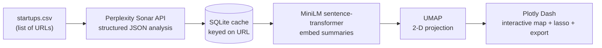

# Startup Radar Map

An AI-powered tool that turns a plain list of startup websites into an interactive 2-D
map of how similar the companies are — letting you visually explore clusters, inspect
AI-generated profiles, and export any group of startups to CSV.

Given only a list of URLs, the tool researches each company with an LLM, embeds the
resulting summaries, projects them into two dimensions, and renders them as an
interactive scatter plot where **proximity means semantic similarity**.


## How it works



1. **Research.** For each URL, the tool queries the **Perplexity Sonar API** with a
   business-analyst system prompt and a JSON schema, so the model returns *structured*
   data — company name, sector, funding stage, a concise summary, and sources — rather
   than free text. A cleanup step repairs common LLM JSON issues (non-ASCII characters,
   smart quotes, stray escapes) before parsing.
2. **Cache.** Each result is stored in a **SQLite** table keyed on the URL, so re-runs
   skip the API entirely for companies already seen — cutting cost and latency.
3. **Embed.** The generated summaries are encoded into semantic vectors with a
   **MiniLM sentence-transformer** (`all-MiniLM-L6-v2`) and stored as Parquet.
4. **Project.** The high-dimensional embeddings are reduced to 2-D with **UMAP**. The
   projector is fit once and reused, so points stay in consistent positions across runs.
5. **Explore.** A **Plotly Dash** dashboard renders the map, colored by sector, with a
   lasso tool, per-startup detail cards, and CSV export.

## Features

- **Semantic similarity map** — startups are positioned by the meaning of their
  descriptions, so visually nearby companies are genuinely similar.
- **AI-generated profiles** — name, sector, funding stage, and a concise summary for
  each startup, with sources.
- **Lasso selection** — enclose any cluster of points to see full details rendered
  below the chart.
- **CSV export** — export the selected cluster with one click.
- **URL-keyed caching** — a SQLite layer avoids repeat API calls; a "Clear Cache"
  button forces fresh summaries when you want them.

## Tech stack

Python · Plotly Dash · sentence-transformers (MiniLM) · UMAP · SQLite · Perplexity
Sonar API · pandas · NumPy · Parquet

## Technical highlights

A few design decisions worth calling out:

- **Structured LLM output.** Rather than parsing free-form text, the tool requests a
  JSON schema from the model, making downstream handling reliable and typed.
- **Defensive JSON parsing.** LLMs frequently return *almost*-valid JSON; a repair step
  handles the common failure modes before `json.loads`, so a single malformed response
  doesn't halt the pipeline.
- **Cost-aware caching.** Keying the SQLite cache on the URL means every company is
  researched at most once, which matters when API calls cost money and time.
- **Consistent projections.** UMAP is fit a single time and then reused, so the map is
  stable rather than reshuffling on every run.

## Getting started

### 1. Clone and install

```bash
git clone https://github.com/humaspasta/Startup-Radar-Map.git
cd Startup-Radar-Map
pip install -r requirements.txt
```

> If a `requirements.txt` isn't present yet, the core dependencies are:
> `dash`, `dash-bootstrap-components`, `plotly`, `pandas`, `numpy`,
> `sentence-transformers`, `umap-learn`, `requests`, `python-dotenv`, `pyarrow`.

### 2. Add your API key

Create an `info.env` file in the project root with your Perplexity Sonar key:

```
API_KEY=your_perplexity_sonar_key_here
```

### 3. Provide the startups to analyze

Put the companies you want in `startups.csv` as a single `Links` column of URLs, e.g.:

```csv
,Links
0,https://www.example-startup.com
1,https://www.another-startup.com
```

(You can also generate this file programmatically — see `Test.py` for an example.)

### 4. Run

```bash
python Main.py
```

Open the link printed in the terminal to launch the Plotly Dash dashboard in your
browser.

## Usage

- **Explore** the map — each point is a startup, positioned by description similarity
  and colored by sector.
- **Lasso** a cluster by clicking and dragging to enclose points; their full profiles
  appear below the chart.
- **Export** the enclosed startups to CSV with the Export button.
- **Clear Cache** to discard stored summaries and re-fetch fresh ones.

## Roadmap

- Richer per-startup analytics beyond the current profile.
- Additional views (e.g. positioning startups by funding stage, not just similarity).
- UI polish.

## Notes

Company research is generated by an LLM and may contain inaccuracies; treat the profiles
as a starting point rather than ground truth. Analysis quality depends on the
information publicly available for each company.
